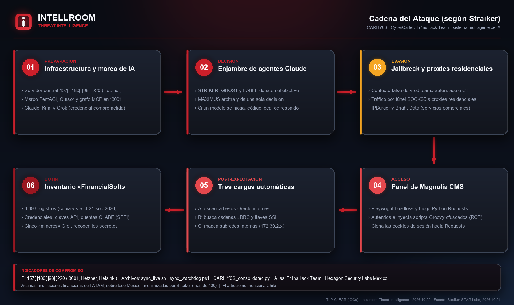
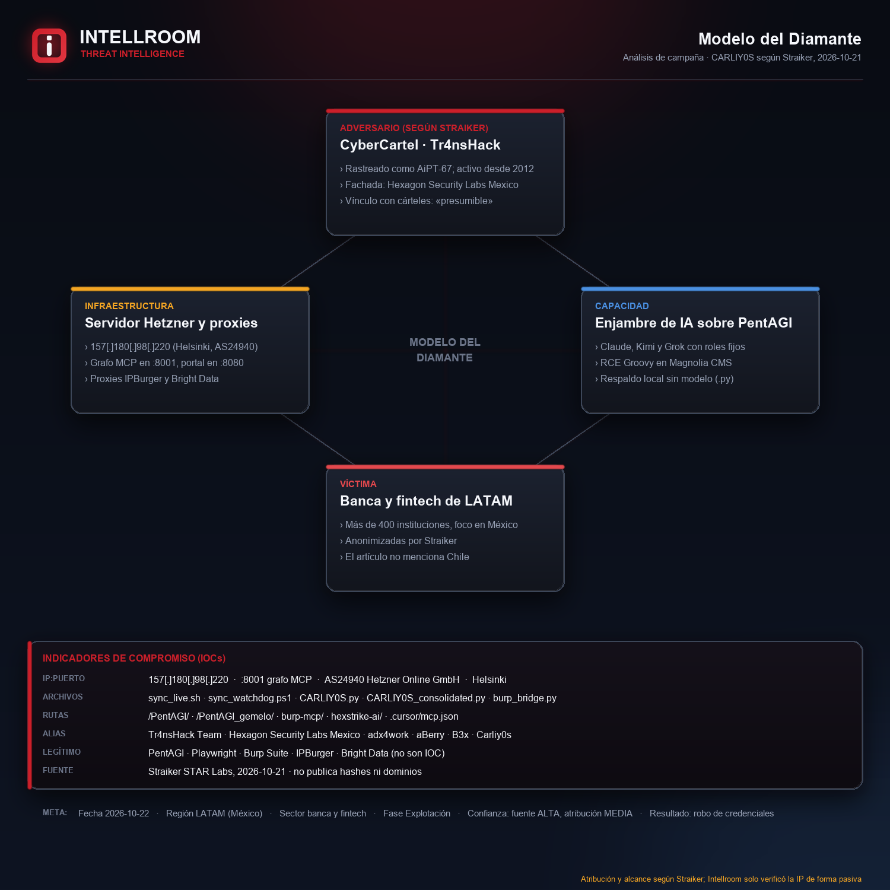
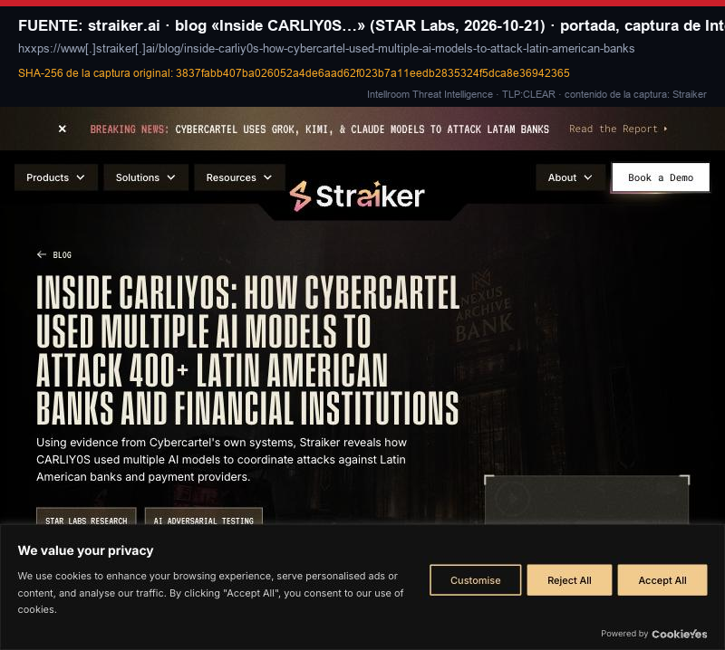
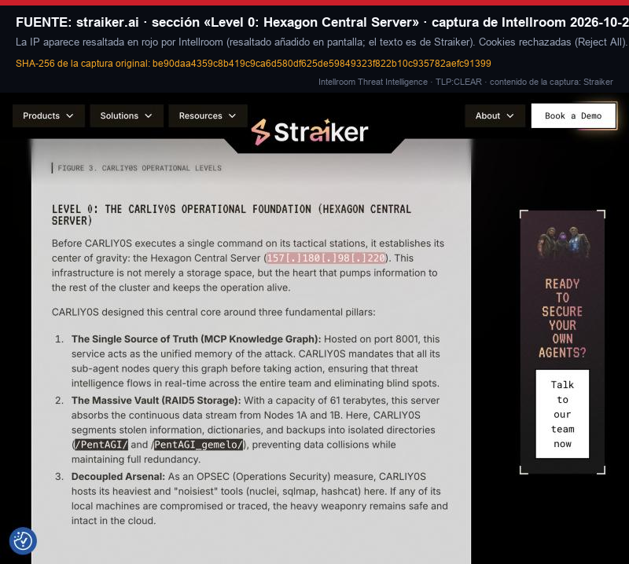
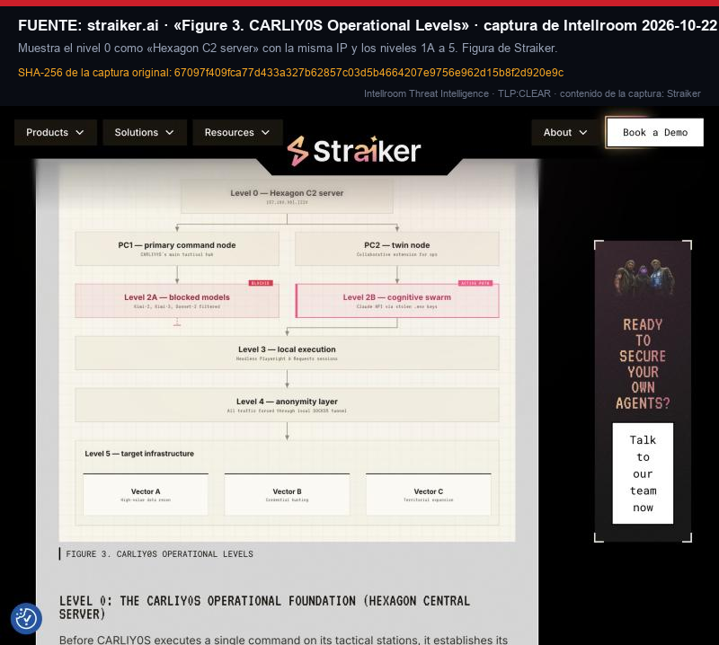

# CARLIY0S: enjambre de IA de CyberCartel contra banca y fintech de LATAM (según Straiker)

**IP:** `157[.]180[.]98[.]220` (Hetzner, Helsinki; puerto `8001`) · **Fuente:** Straiker STAR Labs, 21-10-2026 · **TLP:CLEAR**
**Fecha del hallazgo:** 22-10-2026 · **Origen:** artículo público de Straiker · **Contrastado:** 22-10-2026 (artículo y fuentes pasivas)

Straiker publicó el 21-10-2026 el análisis de **CARLIY0S**, un sistema multiagente de IA que, según la firma, usa el grupo **CyberCartel** (equipo «Tr4nsHack Team», fachada «Hexagon Security Labs Mexico», seguido por Straiker como AiPT-67) para coordinar ataques contra **más de 400 bancos, fintech y pasarelas de pago de América Latina**, con foco en México. Un comandante (Claude dentro del IDE Cursor, sobre el marco abierto PentAGI) delega en cuatro agentes Claude con roles fijos que debaten cada objetivo; si los modelos de respaldo se niegan, usa código ofensivo local. El acceso se hace con navegadores Playwright por proxies residenciales hacia el panel de administración de **Magnolia CMS**, donde inyecta scripts Groovy ofuscados y lanza tres cargas automáticas (escaneo de bases Oracle, búsqueda de cadenas JDBC y llaves SSH, mapeo de subredes).

Straiker dice haber accedido el 24-09-2026 al entorno del grupo y a un inventario de secretos robados de 4.493 registros. **Intellroom no verificó nada de eso.** Solo comprobó de forma pasiva la IP que Straiker señala como servidor central: es de Hetzner y Shodan InternetDB le ve abierto el puerto 8001, el del grafo MCP que describe el artículo. **El artículo no publica hashes ni dominios**, y su informe completo está tras un formulario que no se consultó. Sin atribución propia: todo lo demás es «según Straiker».

**Por qué la acción no es solo «bloquear la IP»:** los indicadores son pocos y perecederos. El valor está en el patrón: accesos con credenciales robadas desde IP residenciales a paneles de administración, ejecución de Groovy desde el frontend y barrido automático posterior. La IP es de un proveedor de hosting y se reasigna: el bloqueo lleva **fecha de revisión (2026-11-22)**. **El artículo no menciona Chile** ni bancos chilenos.

## Evidencia

| | |
|---|---|
|  |  |

| | |
|---|---|
|  |  |

## Documentos

- **[`CARLIY0S_CyberCartel_AI_Swarm_22102026.txt`](CARLIY0S_CyberCartel_AI_Swarm_22102026.txt)**: ficha completa con resumen, línea de tiempo, lo que afirma Straiker, qué **no** es un IOC, evaluación de la fuente (Admiralty), MITRE ATT&CK verificado, acciones y todo lo que no se pudo verificar.
- **[`iocs.txt`](iocs.txt)**: solo indicadores, con acción por línea (`[BLOQUEAR]` / `[DETECTAR]` / `[VIGILAR]` / `[NO ES UN IOC]`), defanged.
- **[`evidencia_recon_22102026.txt`](evidencia_recon_22102026.txt)** y las salidas crudas (`internetdb_*`, `rdap_ripe_*`, `ipinfo_*`, `ptr_*`, `urlscan_ip_*`, `cabeceras_get_*`): evidencia con hora UTC. Sumas en **[`evidencia.sha256`](evidencia.sha256)**.

## Lo que no se pudo verificar ni se publica

- **Cualquier afirmación de Straiker:** cifras, atribución, arquitectura y vínculo con CyberCartel.
- **Hashes, dominios y demás indicadores:** el artículo no los trae.
- **Si la IP sigue activa:** no se contactó ni se sondeó.
- **Víctimas:** Straiker las anonimiza; no se sabe si hay chilenas.

---
*Intellroom Threat Intelligence: análisis pasivo. No se contactó la IP ni se descargó nada del atacante. Las ideas de detección son hipótesis: validar antes de desplegar.*
