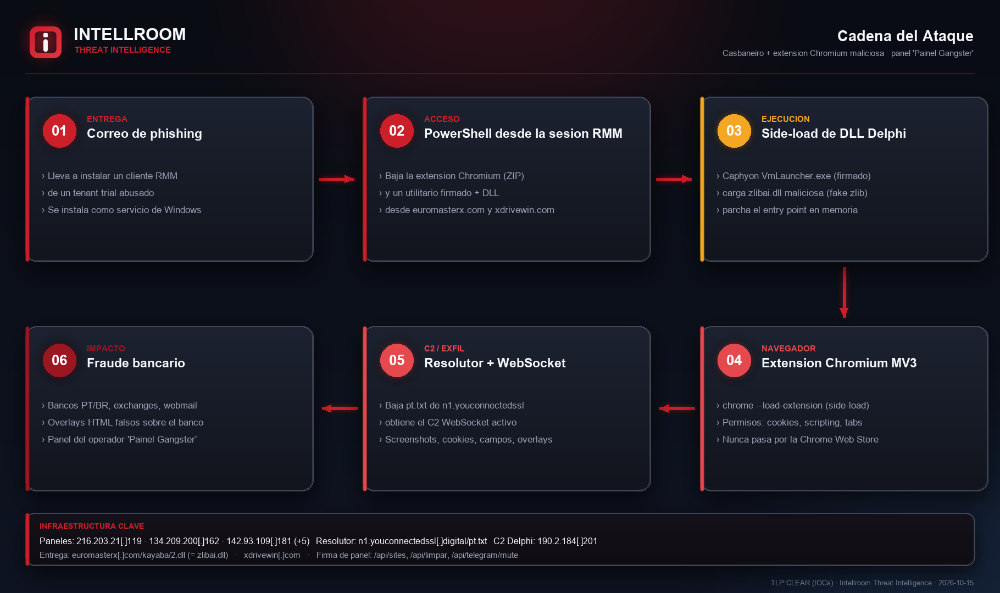
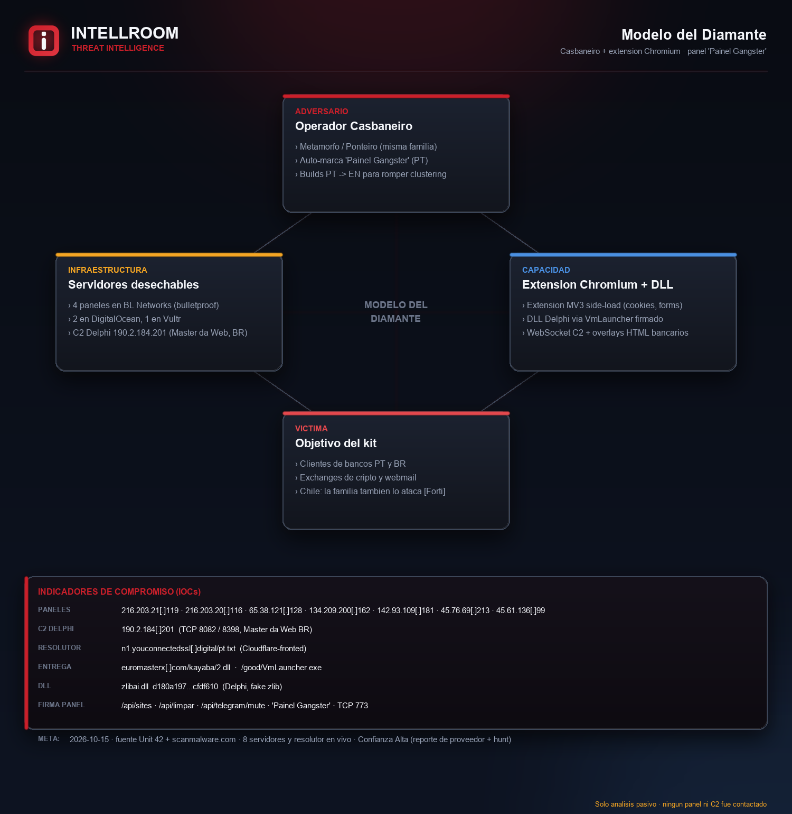
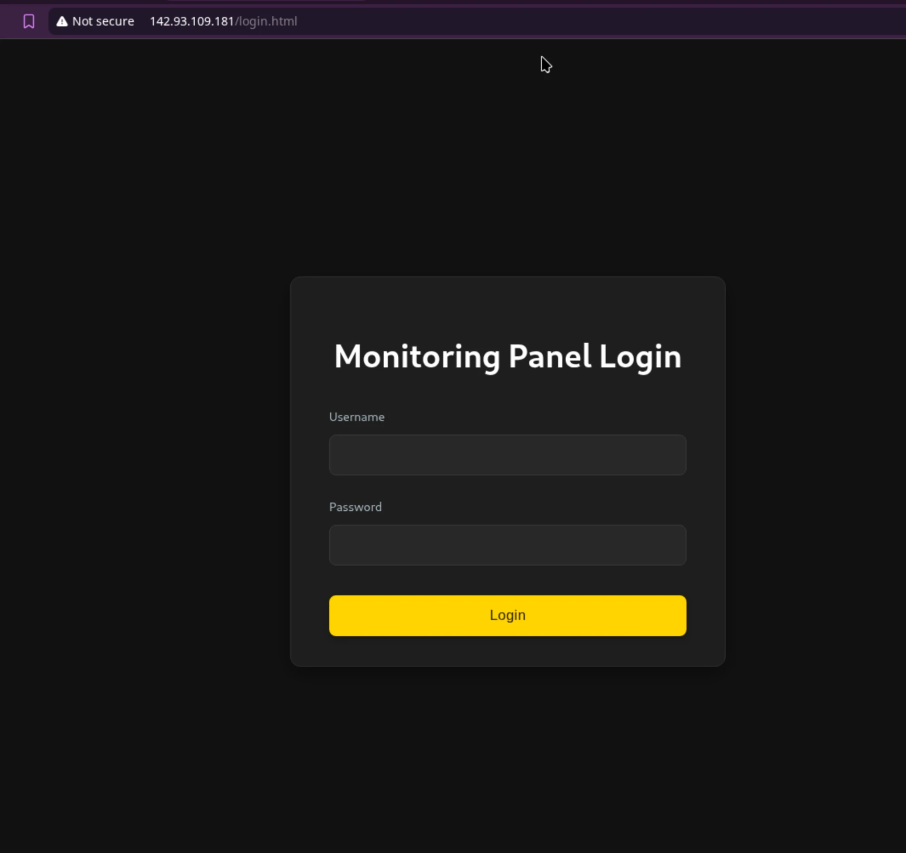

# Casbaneiro + extensión Chromium maliciosa · panel "Painel Gangster"

**TLP:CLEAR** · Intellroom Threat Intelligence · 2026-10-15

Casbaneiro (también rastreado como **Metamorfo** y **Ponteiro**), troyano bancario de
LATAM, se distribuye en esta oleada junto a una **extensión de navegador Chromium
maliciosa** que roba cookies, captura cada campo de formulario (incluidas contraseñas),
toma capturas de pantalla e inyecta superposiciones HTML falsas sobre las páginas del
banco. La extensión y el troyano se controlan desde un **panel web de operador** que los
propios operadores marcan **"Painel Gangster"** (login *"Painel de Monitoramento"* en
portugués, *"Monitoring Panel Login"* en el build en inglés).

La cadena parte de un correo de phishing que lleva a instalar un cliente de un producto
legítimo de **acceso remoto (RMM)** desde un tenant de prueba del atacante. Con esa sesión
el operador corre PowerShell, baja la extensión y un utilitario firmado de Caphyon
(`VmLauncher.exe`) junto a una **DLL Delphi** (`zlibai.dll`) que suplanta a la librería
zlib y se carga por orden de búsqueda. La extensión resuelve su C2 descargando `pt.txt`
de un host resolutor y mantiene un **WebSocket** con ese servidor.

El objetivo del kit son clientes de ~65 portales bancarios **portugueses y brasileños**,
11 exchanges de cripto y varios webmail. La familia Casbaneiro **también ataca bancos
chilenos** (FortiGuard, 10-sep-2026, ya cargado en la instancia VTF); esta oleada apunta a
PT/BR y se reporta por ser la misma familia con una variante nueva (extensión + panel).

**Infraestructura:** 8 servidores — 4 paneles en **BL Networks** (hosting a prueba de
balas), 2 en DigitalOcean, 1 en Vultr, y el C2 Delphi en Master da Web (Brasil). Resolutor
`n1.youconnectedssl[.]digital` detrás de Cloudflare; entrega por `euromasterx[.]com` y
`xdrivewin[.]com`. **Detectado en vivo el 2026-10-15** por el hunt de scanmalware.com.

> **Solo análisis pasivo.** No se contactó ningún panel ni C2. La única interacción fue la
> lectura de la página pública del hunt y una captura del login del panel 142.93.109.181
> (documentado por la fuente como alcanzable por HTTP plano).

## Diagramas y evidencia

| | |
|---|---|
|  |  |
|  | Captura del login del panel ("Monitoring Panel Login", build EN) |

## Archivos

- **`Casbaneiro_Painel_Gangster_Panel_15102026.txt`** — ficha completa: cadena, infraestructura, firma del panel, MITRE ATT&CK, LO QUE NO ES UN IOC, evidencia y recomendaciones.
- **`iocs.txt`** — indicadores con acción por línea (`[BLOQUEAR]` · `[DETECTAR]` · `[VIGILAR]` · `[NO ES IOC]`), defanged.
- **`evidencia_*.txt`** — evidencia cruda con hora UTC: hunt de scanmalware, nota de Unit 42, RDAP/ASN, DNS/CT.
- **`evidencia.sha256`** — sumas de todo lo anterior.

## Firma de detección del panel

Rutas expuestas por los paneles "Painel Gangster" (útiles juntas como firma de escaneo):
`/api/sites` · `/api/custom_html_for_auto_injection?url=` · `/api/limpar` · `/api/telegram/mute` · `/sounds/notification.mp3`.
Más: texto `Painel Gangster`, login `Monitoring Panel Login`, puerto admin `TCP 773`, e IDs DOM de overlay `__ext_injected_overlay_wrapper_id_`.

## Fuentes

- Unit 42 (Palo Alto Networks), 2026-10-13 — *Casbaneiro Banking Trojan Paired With Malicious Chromium Extension…* ([repo público](https://github.com/PaloAltoNetworks/Unit42-timely-threat-intel/blob/main/2026-10-13-Casbaneiro-Banking-Trojan.txt)).
- scanmalware.com, hunt `casbaneiro-extension-panel-2026-10` (short `scanmalware.com/h/287`).
- Enriquecimiento propio: RDAP (ARIN/LACNIC), ASN (Team Cymru), DNS (8.8.8.8), crt.sh.
