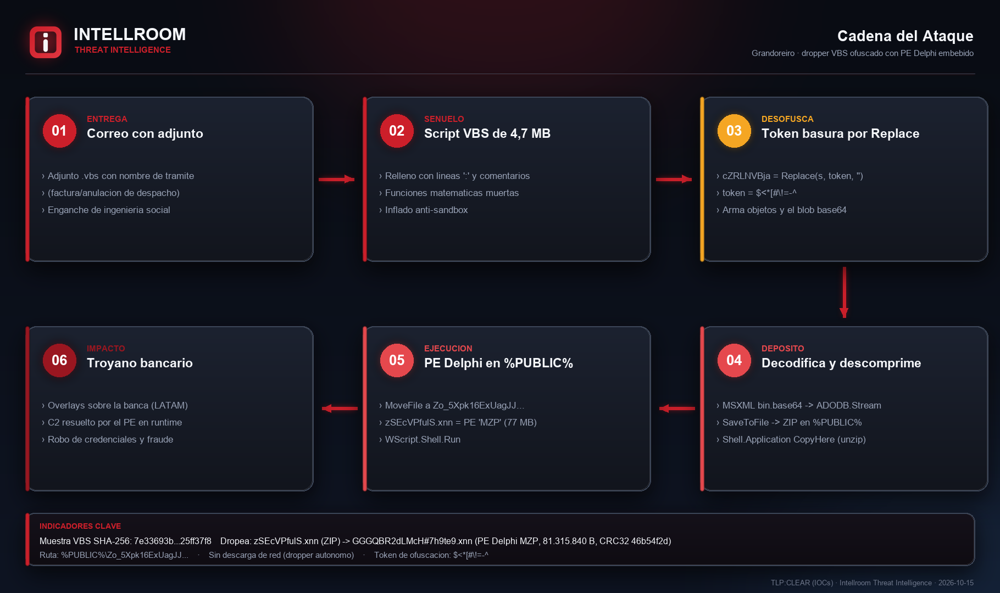
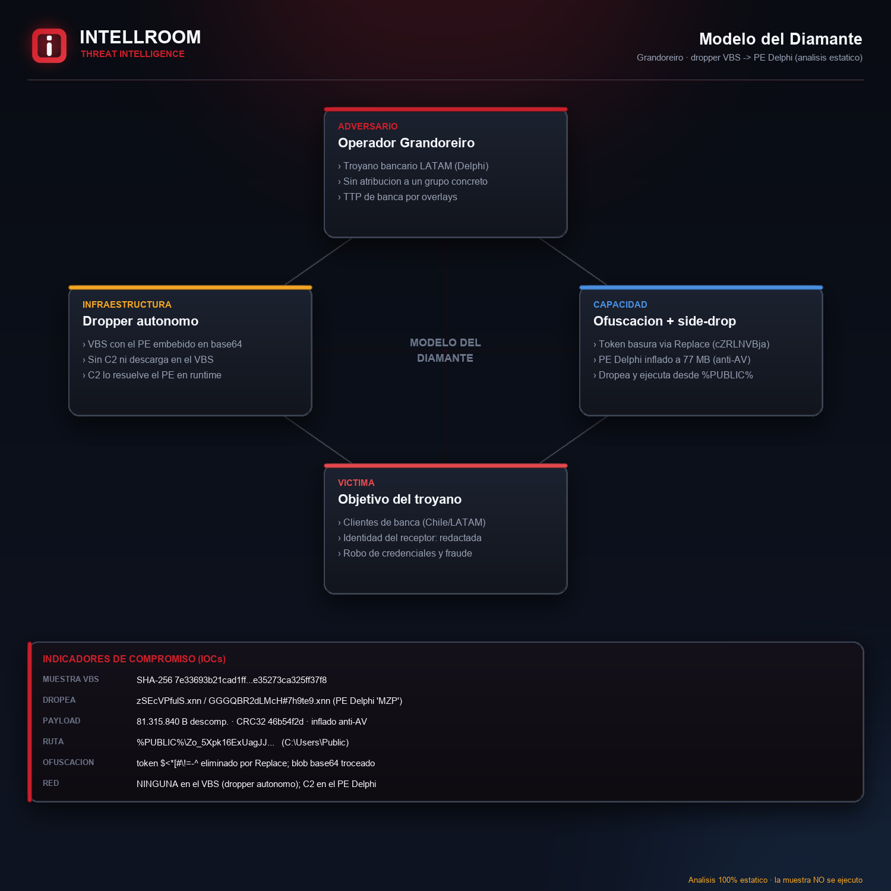

# Grandoreiro · dropper VBS ofuscado con PE Delphi embebido

**TLP:CLEAR** · Intellroom Threat Intelligence · 2026-10-15

Adjunto `.vbs` (4,7 MB) de un correo con nombre de trámite (`...Anul_Dsp_Recep...`) que resultó
ser un **dropper autónomo de Grandoreiro** (troyano bancario de LATAM, familia Delphi). Análisis
**100% estático**: la muestra se leyó como datos; **nunca se ejecutó**.

**Ofuscación:** relleno con líneas de `:` y comentarios de palabras-basura, funciones matemáticas
muertas, y un token literal `$<*[#\!=-^` intercalado entre fragmentos de cadena que la función
`cZRLNVBja` elimina (`Replace(s, token, "")`).

**Cadena:** el VBS arma un blob **base64 de ~3,17 MB** troceado en el propio script, lo decodifica
con **MSXML `bin.base64` + ADODB.Stream** y lo escribe como **ZIP** en `%PUBLIC%`; lo descomprime con
**Shell.Application.CopyHere** (sin utilidad externa); mueve el PE extraído a
`%PUBLIC%\Zo_5Xpk16ExUagJJ...` y lo ejecuta con **WScript.Shell.Run**. El payload es
`zSEcVPfulS.xnn` → **PE Delphi** (empieza con `MZP`), **inflado a 81.315.840 B (~77,6 MB)** desde
3 MB comprimidos — técnica anti-sandbox/AV de Grandoreiro.

**Sin red en el VBS:** es un dropper autónomo; el C2 lo resuelve el PE Delphi en runtime (fuera de
este análisis del dropper).

> **Solo análisis estático.** La muestra no se ejecutó (ni `cscript` ni intérprete). Las muestras
> vivas no deben subirse a servicios públicos sin decidirlo: aquí no se compartió el binario.

## Diagramas

| | |
|---|---|
|  |  |

## Archivos

- **`Grandoreiro_VBS_Dropper_15102026.txt`** — ficha completa.
- **`iocs.txt`** — indicadores con acción por línea (defanged).
- **`evidencia_deofuscacion_15102026.txt`** — paso a paso de la desofuscación, con hora UTC y hashes.
- **`evidencia.sha256`** — sumas.

## IOC principal

`SHA-256 7e33693b21cad1ffd12c7e9b9b6a139ac5686eb58161e93e35273ca325ff37f8` (el VBS). Dropea un PE
Delphi `.xnn` a `%PUBLIC%\Zo_5Xpk16ExUagJJ...` (CRC32 `46b54f2d`, 81.315.840 B). Detección por el
token `$<*[#\!=-^`, los nombres `zSEcVPfulS.xnn` / `GGGQBR2dLMcH#7h9te9.xnn`, y el patrón
SaveToFile→CopyHere→Run de un PE `MZP` en `%PUBLIC%`.
