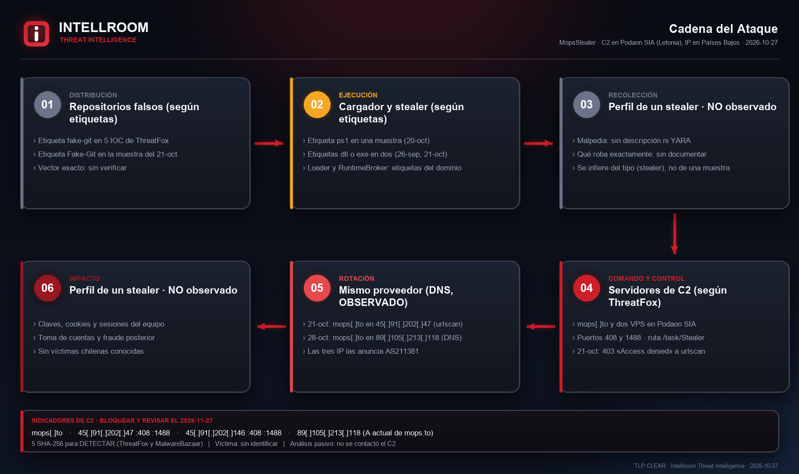
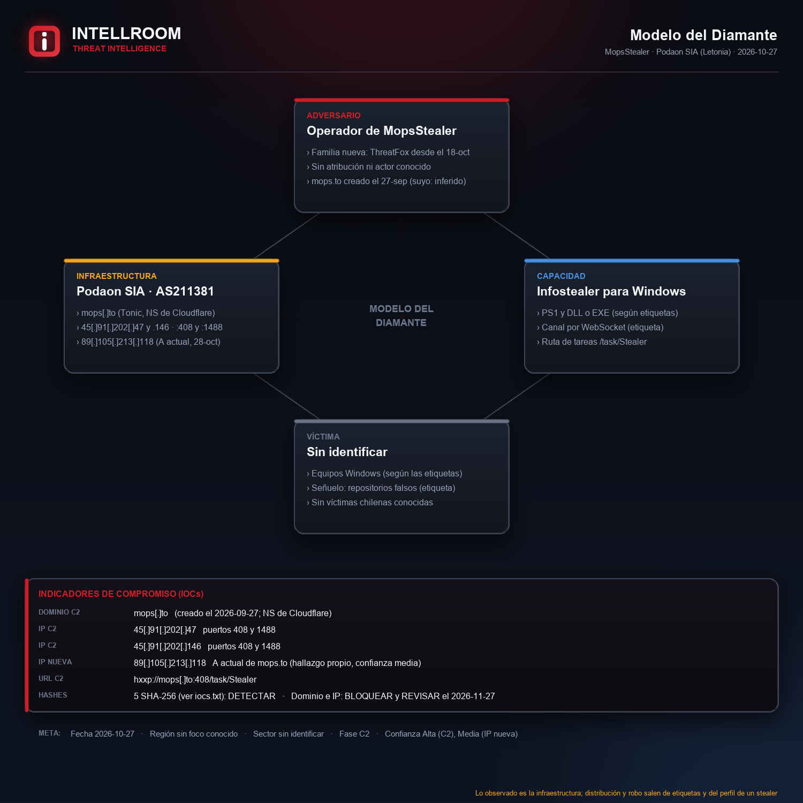
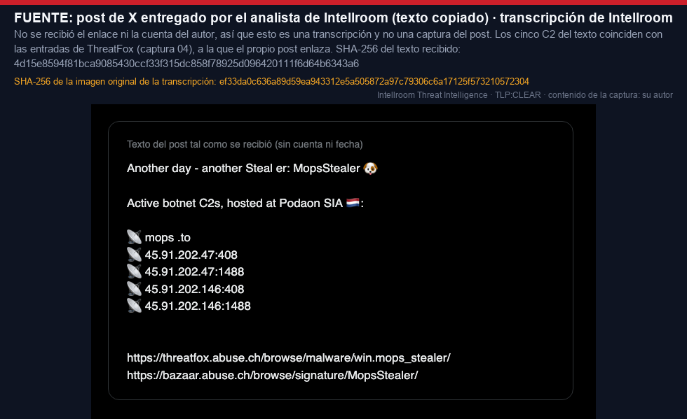
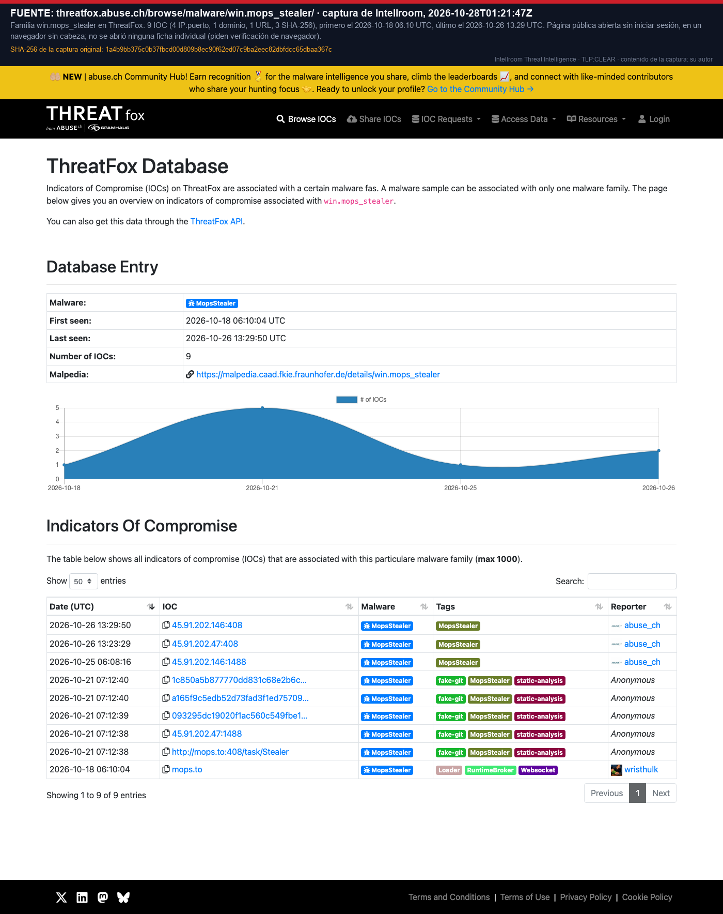
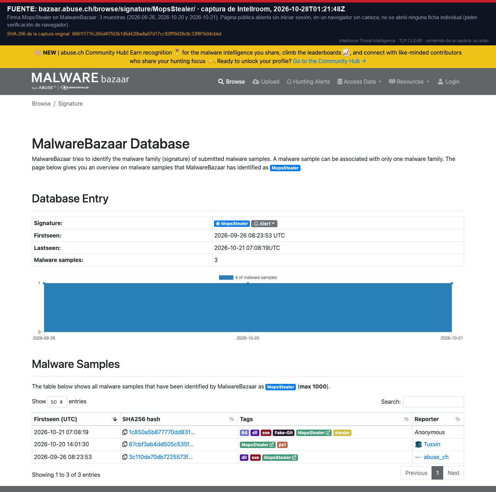
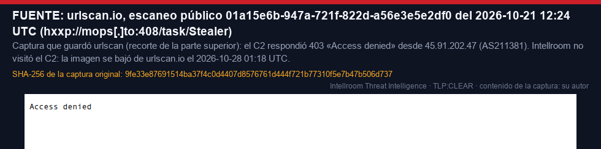

# MopsStealer: C2 del infostealer en Podaon SIA (IP en Países Bajos)

**Dominio:** `mops[.]to` · **IP:** `45[.]91[.]202[.]47` y `45[.]91[.]202[.]146` (puertos 408 y 1488), más `89[.]105[.]213[.]118` (hallazgo propio) · **Hosting:** Podaon SIA (empresa de Letonia), AS211381, IP en Oude Meer (NL) · **TLP:CLEAR**
**Fecha del análisis:** 27-10-2026 · **Origen:** post de X entregado como texto · **Contrastado:** ThreatFox, MalwareBazaar, Malpedia y fuentes pasivas · **Versión:** v2 (28-10-2026), corregida tras una auditoría independiente

**MopsStealer** es una familia nueva de infostealer para Windows: su primera muestra en MalwareBazaar es del 26-09-2026 y su primer indicador en ThreatFox del 18-10-2026. Malpedia la registra **sin descripción ni reglas YARA**, así que casi no hay documentación pública de lo que roba.

Un post de X anuncia **cinco C2 activos** en Podaon SIA: el dominio `mops[.]to` y dos IP, cada una en los puertos **408 y 1488**. Los cinco coinciden con ThreatFox, a la que el propio post enlaza, así que no son dos fuentes independientes. La confianza se apoya en que **tres reportantes distintos** los cargaron en ThreatFox y en que el C2 **respondió 403** a un escaneo de urlscan en `/task/Stealer`. ThreatFox y MalwareBazaar suman **cinco hashes**; sus tipos (PowerShell, DLL o EXE) salen de etiquetas, no del archivo. Las etiquetas `fake-git` apuntan a **repositorios falsos de software** como vía de entrega: no está verificado.

**Hallazgo propio:** el 28-10-2026 a las 01:17 UTC `mops[.]to` ya no apunta a `45[.]91[.]202[.]47` (como el 21-10 según urlscan) sino a **`89[.]105[.]213[.]118`**, anunciada por el mismo sistema autónomo AS211381 y con la misma convención de DNS inverso. No está en la familia de ThreatFox: se publica con confianza media. Su WHOIS dice «Avira Private Cloud», un registro que no coincide con el anuncio; no es un falso positivo.

Intellroom **no contactó el C2 ni descargó muestras**. No hay víctimas chilenas conocidas: el post y las fuentes no mencionan Chile ni LATAM.

**Por qué el bloqueo lleva fecha:** la infraestructura ya se movió una vez en una semana. El dominio es dedicado y se bloquea entero; las IP son VPS reasignables y se **revisan el 2026-11-27**. Una resolución DNS de `mops[.]to` es motivo para **investigar**, no prueba de infección: también la hacen los sandbox, los escáneres de correo y los analistas.

## Correlación

Misma **categoría** (infostealers con C2 propio) que otros casos publicados: [Phexia_macOS_Polygon_C2](../Phexia_macOS_Polygon_C2) y [Macfinger_ClickFix_macOS](../Macfinger_ClickFix_macOS). Son familias distintas: MopsStealer es de Windows y, según las etiquetas, llega por repositorios falsos, no por ClickFix. Es correspondencia de tipo de amenaza, no de identidad.

## Evidencia

| | |
|---|---|
|  |  |

| | |
|---|---|
|  |  |

## Documentos

- **[`MopsStealer_C2_Podaon_27102026.txt`](MopsStealer_C2_Podaon_27102026.txt)**: ficha completa con resumen, línea de tiempo, lo observado, qué **no** es un IOC, evaluación de la fuente (Admiralty), MITRE ATT&CK (IDs verificados, asignación inferida), acciones, lo que no se pudo verificar y los cambios de la v2.
- **[`iocs.txt`](iocs.txt)**: solo indicadores, con acción por línea (`[BLOQUEAR]` / `[DETECTAR]` / `[VIGILAR]` / `[NO ES UN IOC]`), defanged.
- **[`evidencia_recon_27102026.txt`](evidencia_recon_27102026.txt)** y los RDAP de RIPE (`rdap_ripe_*.json`, recortados a las organizaciones): evidencia con hora UTC. Sumas en **[`evidencia.sha256`](evidencia.sha256)**.

## Lo que no se pudo verificar ni se publica

- **El autor y la fecha del post:** se recibió solo el texto.
- **Qué roba MopsStealer y cómo habla con el C2:** no hay análisis público y no se ejecutó ninguna muestra.
- **El tipo real de los cinco archivos:** solo hay etiquetas, y dos hashes no tienen ninguna de tipo.
- **Si los puertos 408 y 1488 siguen activos** y si `89[.]105[.]213[.]118` sirve hoy el C2: no se contactó.
- **Víctimas y atribución:** ninguna conocida.

---
*Intellroom Threat Intelligence: análisis pasivo. No se contactó el C2 ni se descargó nada del atacante. Las ideas de detección son hipótesis: validar antes de desplegar.*
