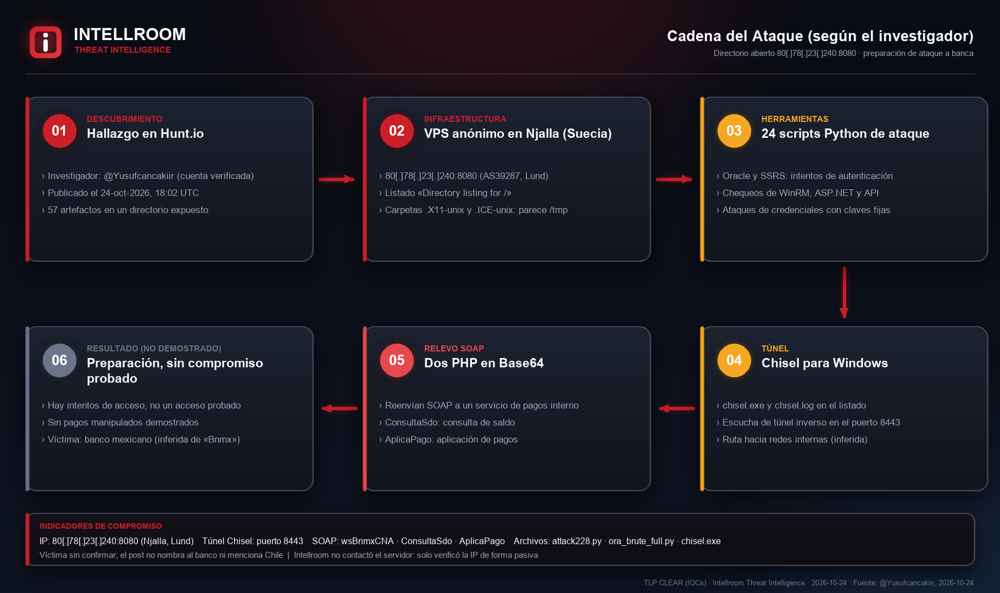
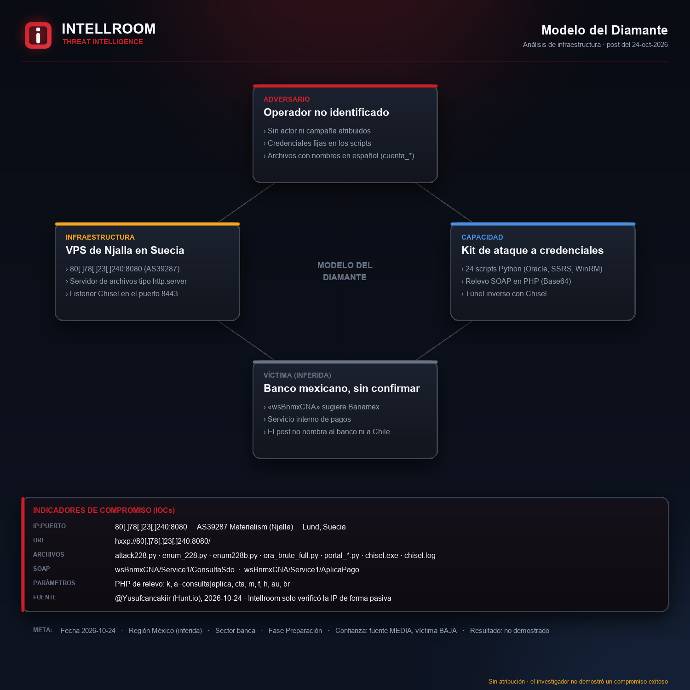
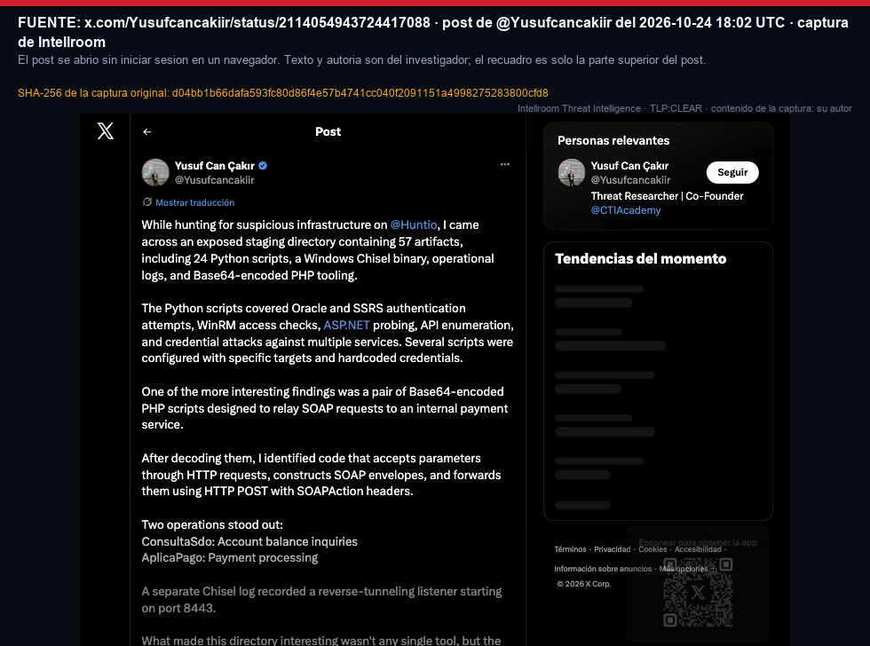
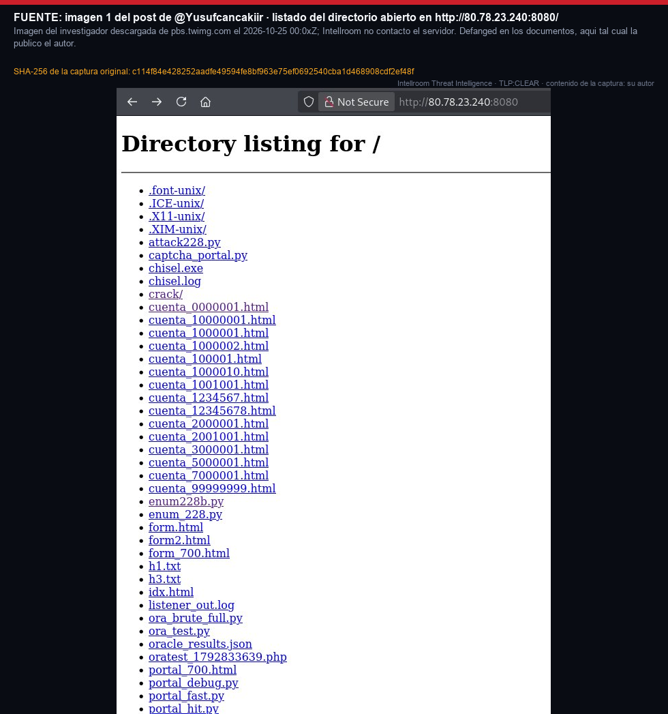
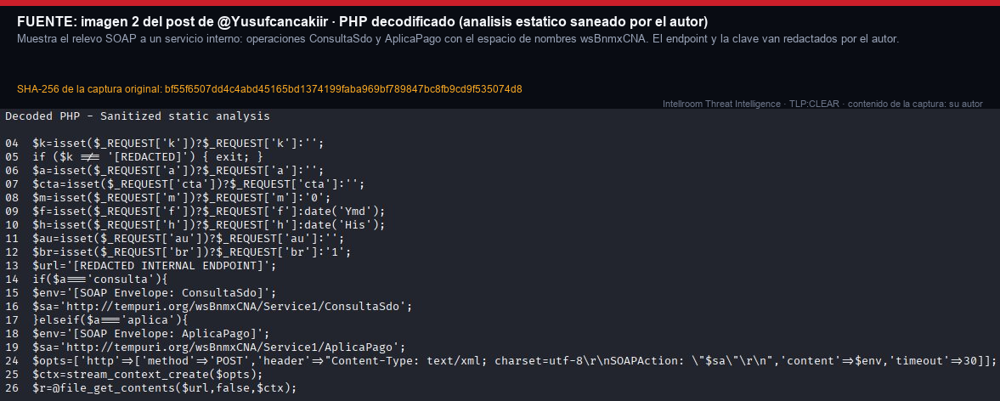

# Directorio abierto con kit de ataque a credenciales y relevo SOAP de pagos (según un investigador)

**IP:** `80[.]78[.]23[.]240` · **Servicio:** `hxxp://80[.]78[.]23[.]240:8080/` (directorio abierto) · **Hosting:** Njalla, Lund, Suecia (AS39287) · **TLP:CLEAR**
**Fecha del hallazgo:** 24-10-2026 · **Origen:** post público de [@Yusufcancakiir](https://x.com/Yusufcancakiir/status/2114054943724417088) · **Contrastado:** 25-10-2026 (el post, sus dos imágenes y fuentes pasivas)

El 24-10-2026 un investigador publicó que, buscando infraestructura sospechosa en Hunt.io, encontró un **directorio de staging expuesto con 57 artefactos**: 24 scripts Python, un binario de **Chisel** para Windows, registros operativos y herramientas PHP en Base64. Según él, los scripts intentan autenticarse contra **Oracle y SSRS**, comprueban acceso por **WinRM**, sondean ASP.NET y APIs y hacen ataques de credenciales con claves escritas en el código. Dos PHP en Base64, ya decodificados, **reenvían SOAP a un servicio interno de pagos** con las operaciones `ConsultaSdo` (consulta de saldo) y `AplicaPago`, bajo el espacio de nombres `wsBnmxCNA`. Un registro de Chisel muestra un listener de túnel inverso en el puerto **8443**.

El propio investigador concluye que los archivos prueban **preparación de ataque e intentos de acceso, pero no un compromiso exitoso** ni manipulación de pagos. «Bnmx» sugiere un banco mexicano (Banamex), pero es **inferencia de Intellroom**: el investigador no nombra el banco y redactó el endpoint. **El post no menciona Chile.**

Intellroom **no contactó el servidor ni descargó ningún archivo**: lo observado sale del post y de sus dos imágenes. La IP solo se consultó de forma pasiva y **nada la corrobora de forma independiente** (Shodan InternetDB y urlscan no tienen datos). Sin atribución, actor ni familia.

**Por qué la acción no es solo «bloquear la IP»:** el indicador de red es débil y la IP es de un VPS que se reasigna: el bloqueo lleva **fecha de revisión (2026-11-24)**. Lo útil son los patrones: ráfagas de autenticación contra Oracle, SSRS y WinRM desde un mismo origen, llamadas SOAP a `ConsultaSdo` o `AplicaPago` desde un origen inesperado y conexiones Chisel.

## Correlación

Misma **familia** que otros casos publicados de infraestructura expuesta como directorio abierto: [OpenDir_AD_Toolkit](../OpenDir_AD_Toolkit), [Erebus_C2_OpenDir](../Erebus_C2_OpenDir), [OpenDir_Operador_SurAsia](../OpenDir_Operador_SurAsia), [Pfcloud_OpenDir_Staging](../Pfcloud_OpenDir_Staging) y [VShell_OpenDir_Migracion_Panel](../VShell_OpenDir_Migracion_Panel). Diferencia: este caso es de preparación contra una plataforma bancaria y de pagos. Es correspondencia de modo de operación, no de identidad.

## Evidencia

| | |
|---|---|
|  |  |

| | |
|---|---|
|  |  |

## Documentos

- **[`OpenDir_Staging_Banca_SOAP_24102026.txt`](OpenDir_Staging_Banca_SOAP_24102026.txt)**: ficha completa con resumen, línea de tiempo, lo observado, qué **no** es un IOC, evaluación de la fuente (Admiralty), MITRE ATT&CK verificado, acciones y todo lo que no se pudo verificar.
- **[`iocs.txt`](iocs.txt)**: solo indicadores, con acción por línea (`[BLOQUEAR]` / `[DETECTAR]` / `[VIGILAR]` / `[NO ES UN IOC]`), defanged.
- **[`evidencia_recon_24102026.txt`](evidencia_recon_24102026.txt)** y las salidas crudas (`internetdb_*`, `rdap_ripe_*`, `ipinfo_*`, `ptr_*`, `urlscan_ip_*`): evidencia con hora UTC. El RDAP va recortado, sin contactos individuales. Sumas en **[`evidencia.sha256`](evidencia.sha256)**.

## Lo que no se pudo verificar ni se publica

- **Cualquier afirmación del investigador:** contenido de los archivos, credenciales y objetivos de los scripts.
- **Si el directorio sigue expuesto:** no se contactó la IP.
- **Hashes de los archivos:** el post no los publica.
- **La víctima:** banco, país y servicio.
- **Atribución:** ninguna.

---
*Intellroom Threat Intelligence: análisis pasivo. No se contactó la IP ni se descargó nada del atacante. Las ideas de detección son hipótesis: validar antes de desplegar.*
