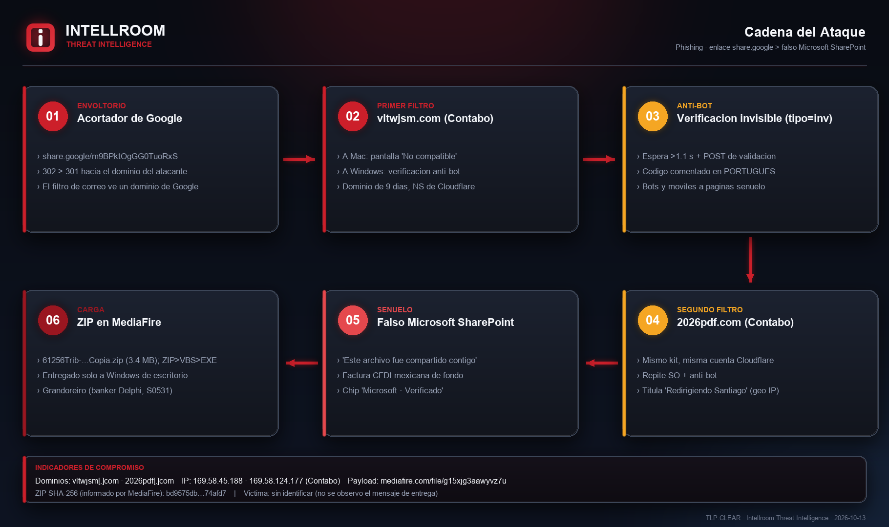
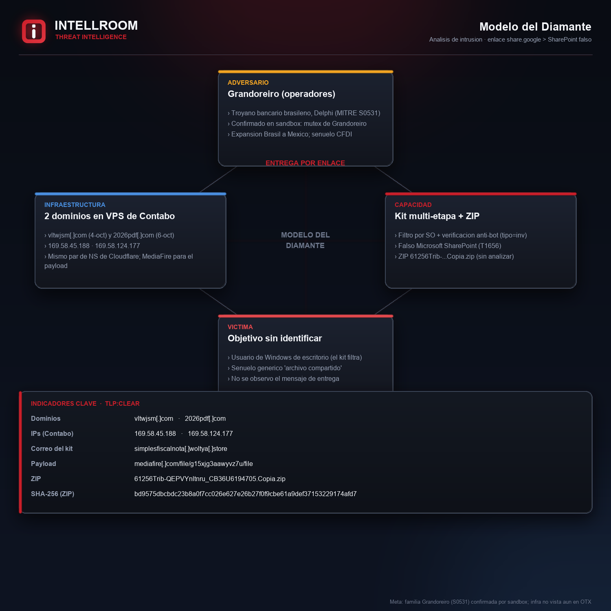
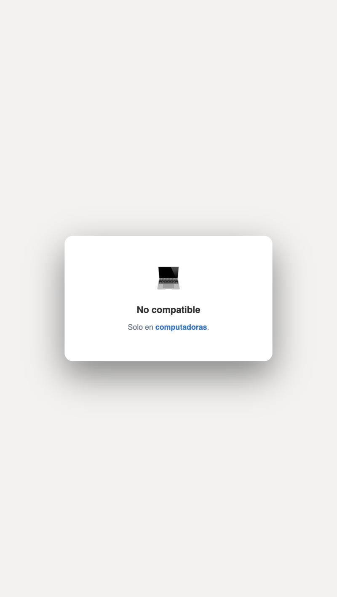
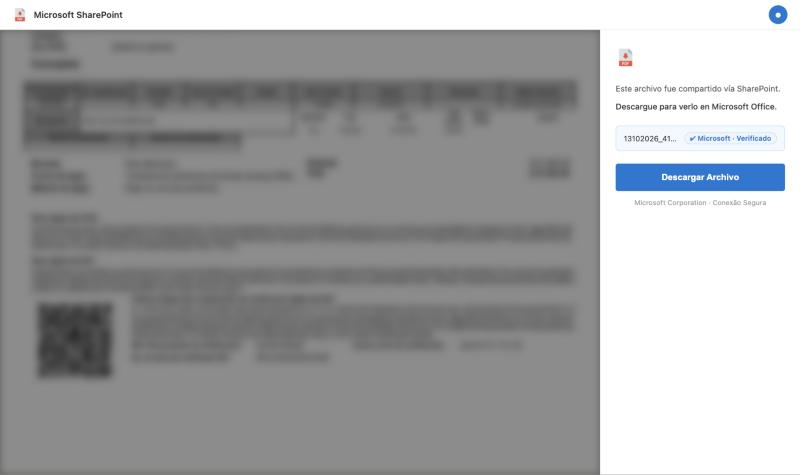
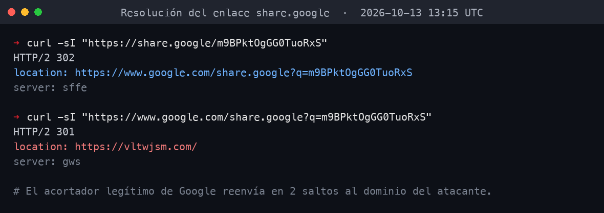
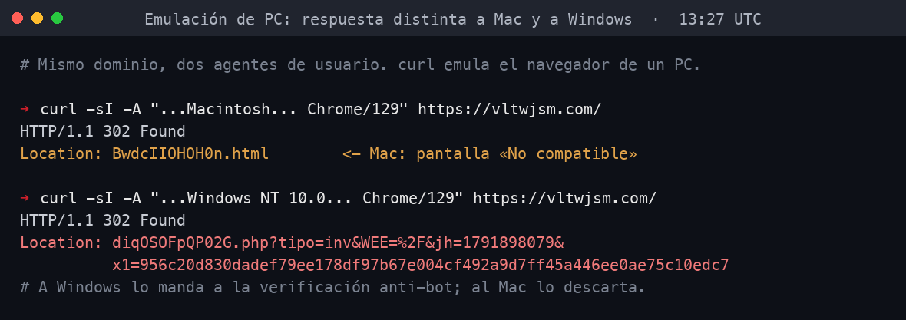
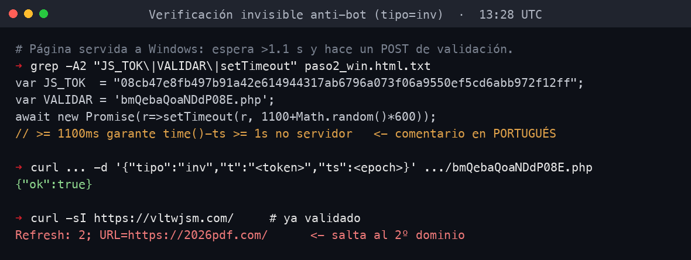
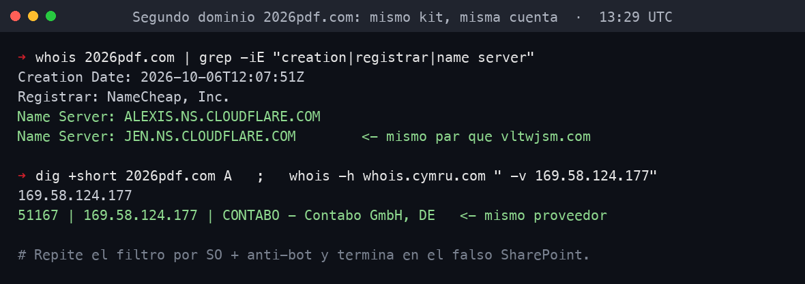
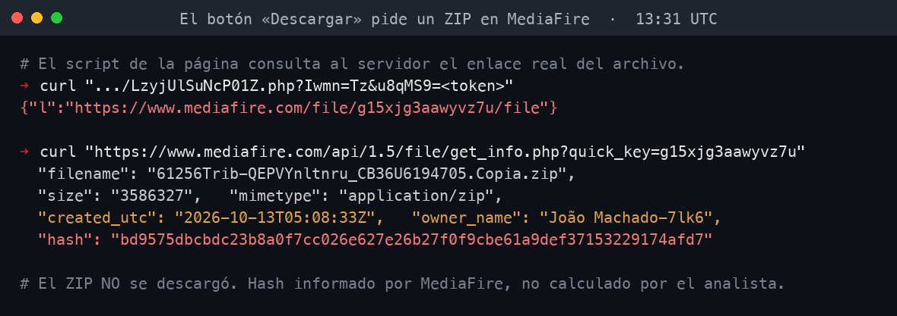
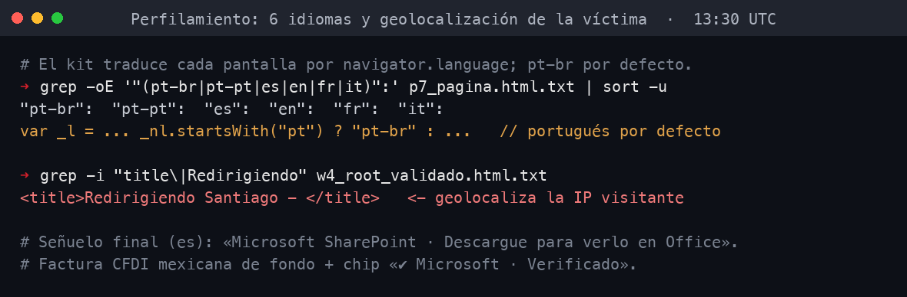

# Phishing por enlace de Google a SharePoint falso con ZIP en MediaFire

**TLP:CLEAR** · Analisis Intellroom CTI · 2026-10-13 (atribucion act. 2026-10-14)

**Atribucion: Grandoreiro** (troyano bancario brasileno, Delphi, MITRE [S0531](https://attack.mitre.org/software/S0531/)), confirmada por analisis en sandbox (ANY.RUN) de un segundo sample de la misma campana (mutex de Grandoreiro). La infraestructura de esta campana no figura aun en AlienVault; el aporte propio es el vector de entrega (share.google + SharePoint falso + MediaFire).

Un enlace acortado de Google (`share.google`) abre, en dos saltos, una cadena de phishing que termina entregando un archivo ZIP. El envoltorio de Google sirve para que el filtro de correo y la persona solo vean un dominio de confianza. La cadena filtra por sistema operativo (solo entrega a Windows de escritorio) e incorpora una verificacion anti-bot invisible basada en tiempo; el codigo del kit esta comentado en portugues y traduce las paginas a seis idiomas, con senuelo de tematica tributaria.

El destino final suplanta a **Microsoft SharePoint**, con una factura electronica de fondo, y entrega un ZIP alojado en **MediaFire**. El hash del ZIP es el que informa MediaFire; el binario no se descargo ni se analizo. Todo el trabajo fue pasivo y dinamico, sin contacto con el C2 mas alla de seguir la cadena como una victima.

Dos capas de evasion destacan: el filtro por sistema operativo deja a Mac y Linux (y a muchos sandboxes) fuera con una pagina benigna "no compatible"; y la puerta de entrada **bloquea por IP** tras repetidas solicitudes, devolviendo 404 en la raiz mientras los estaticos y el payload siguen vivos, de modo que un sitio activo aparenta estar caido.

## Indicadores

Lista completa con accion por linea en [`iocs.txt`](iocs.txt). Ficha completa en [`ShareGoogle_SharePoint_MediaFire_14102026.txt`](ShareGoogle_SharePoint_MediaFire_14102026.txt).

Dominios `vltwjsm[.]com`, `2026pdf[.]com`, `simplesfiscalnota[.]woltya[.]store` · IP `169.58.45[.]188`, `169.58.124[.]177` (Contabo) · payload `mediafire[.]com/file/g15xjg3aawyvz7u` · ZIP SHA-256 `bd9575db...74afd7` (informado por MediaFire).

**Segundo sample** (mismo kit, Grandoreiro en sandbox): enlace `share.google/I91XnAATjc2UHTXwT`, ZIP `54192SerieX304.GX1K4A-UGLZR.Elec.zip` con un VBScript (`_306042Impues-3949_xuley.Procuzzmcp.vbs`, CRC32 `C5B2659C`) que suelta `C:\Users\Public\6TzIetO%8xGvA2Ofo.exe`. SHA-256 pendiente (tarea ANY.RUN).

## Figuras

| | |
|---|---|
|  |  |
|  |  |
|  |  |
|  |  |
|  |  |

## Evidencia

Consolas (salida real de cada comando, con hora UTC) y texto crudo en `evidencia_*.txt`; sumas en [`evidencia.sha256`](evidencia.sha256). No se incluye la imagen cruda de la factura (trae datos de empresas reales); solo aparece borrosa de fondo en la captura del SharePoint falso. El ZIP no se descargo.
